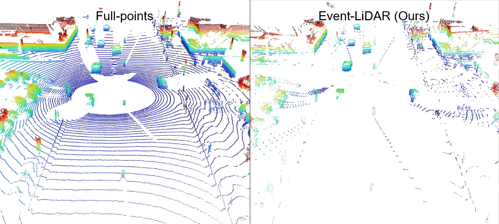
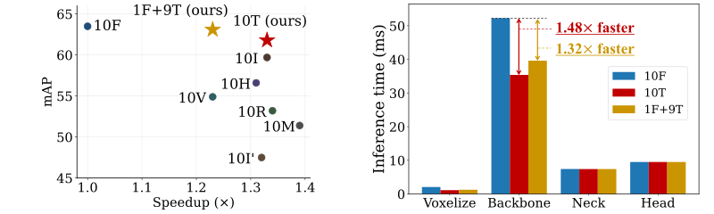
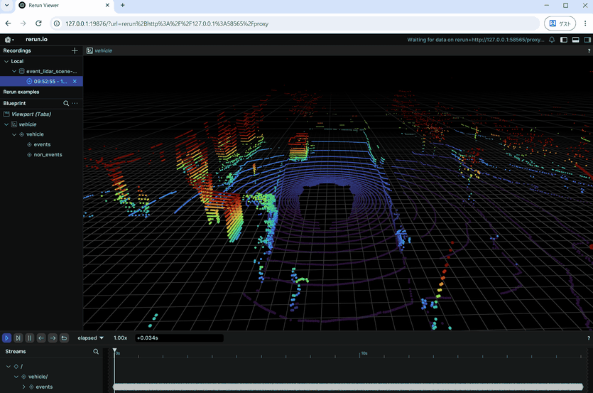

# [ECCV 2026] Event-LiDAR: 3D Eventification for Efficient Point Cloud Processing

Event-LiDAR reduces temporal redundancy in consecutive LiDAR observations to make 3D point cloud processing more efficient.

<p align="center">
  
  <br><br>
  
</p>

## Citation

If you find this project useful in your research, please consider citing:

```bibtex
@inproceedings{murakami2026eventlidar,
  title     = {Event-LiDAR: 3D Eventification for Efficient Point Cloud Processing},
  author    = {Murakami, Masatoshi and Tsuji, Eisho and Sakurada, Ken},
  booktitle = {European Conference on Computer Vision (ECCV)},
  year      = {2026}
}
```

## Requirements

- Python >= 3.8
- CMake >= 3.16
- C++ >= 17
- GCC >= 10, Clang >= 13, or MSVC

## Quick Start

Visualization on nuScenes: event points are colored, and non-event points are gray.

<p align="center">
  
</p>

Use uv to set up the environment and install the non-SIMD version of Event-LiDAR. For instructions on installing uv, see the [official documentation](https://docs.astral.sh/uv/getting-started/installation/).

```bash
git clone https://github.com/scsrp/event-lidar.git
cd event-lidar
```

### nuScenes Dataset

Download and extract [nuScenes mini](https://www.nuscenes.org/nuscenes#download).

```bash
mkdir -p data/nuscenes
wget https://www.nuscenes.org/data/v1.0-mini.tgz -O data/nuscenes/v1.0-mini.tgz
tar -xzf data/nuscenes/v1.0-mini.tgz -C data/nuscenes
```

Create a virtual environment and install Event-LiDAR and its dependencies.

```bash
uv venv .venv-nuscenes --python 3.12 --managed-python
uv pip install --python .venv-nuscenes/bin/python \
  -r scripts/vis_nuscenes/requirements.txt .
```

Apply eventification to scene 0 and visualize the result in the Rerun Web Viewer.

```bash
.venv-nuscenes/bin/python scripts/vis_nuscenes/visualize.py \
  --dataset-root data/nuscenes \
  --scene-index 0 \
  --eventifier-type line \
  --threshold 0.072
```

After running the command, open the `Viewer URL` shown in the terminal in your browser. For more details, see the [nuScenes demo README](../scripts/vis_nuscenes/README.md).

### Waymo Open Dataset

The Waymo demo is not supported on Windows. A single TFRecord file from the Perception Dataset is sufficient to run it.

1. Open the [Waymo Open Dataset download page](https://waymo.com/open/download/) and sign in with your Google account.
2. Open **Perception Dataset → individual files → training** and download any one `.tfrecord` file.
3. Place the downloaded file in `data/waymo/`.

Create a virtual environment and install Event-LiDAR and its dependencies.

```bash
uv venv .venv-waymo --python 3.8 --managed-python
uv pip install --python .venv-waymo/bin/python \
  -r scripts/vis_waymo/requirements.txt .
```

Apply eventification to the scene in the downloaded TFRecord file and visualize the result in the Rerun Web Viewer.

```bash
.venv-waymo/bin/python scripts/vis_waymo/visualize.py \
  --tfrecord-dir data/waymo \
  --scene-index 0 \
  --eventifier-type line \
  --threshold 0.069
```

After running the command, open the `Viewer URL` shown in the terminal in your browser. For more details, see the [Waymo demo README](../scripts/vis_waymo/README.md).

## Threshold

The thresholds above were tuned to achieve approximately 80% point reduction
on average across each dataset's training split.

## License

Event-LiDAR's original source code is licensed under the [BSD 3-Clause License](../LICENSE).

Third-party components retain their own licenses. In particular, the bundled Eigen
5.0.1 is primarily licensed under MPL-2.0. See [Third-party notices](../THIRD_PARTY_NOTICES.md)
for license texts and Eigen source code availability.
